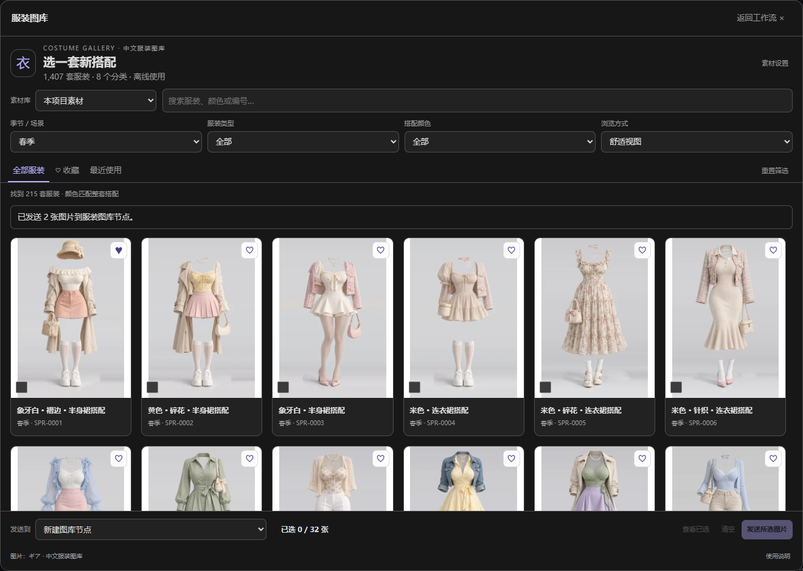

# ComfyUI_Costume-Gallery_ZH

把本项目的 1,407 套服装参考图放进 ComfyUI：侧栏筛选和预览，单张或批量发送到工作流，同时输出原始英文关键词与中文说明。选图与图片输出完全使用本地素材，不需要下载模型。

插件名称统一为 **ComfyUI_Costume-Gallery_ZH**，中文界面显示「服装图库」。这是独立插件，可与 `ComfyUI_Pose-Gallery_ZH` 同时使用。两者的节点、侧栏入口、收藏、最近使用和素材设置分别保存。



## 安装

在 ComfyUI 的 `custom_nodes` 目录打开终端，执行：

```sh
git clone https://github.com/Stone-dielianhua/ComfyUI_Costume-Gallery_ZH.git
```

仓库包含代码与全部素材，下载量约 1.42 GiB。也可在 GitHub 选择 **Code → Download ZIP**，解压后将目录重命名为 `ComfyUI_Costume-Gallery_ZH`。

直接将此文件夹复制到 `ComfyUI/custom_nodes/ComfyUI_Costume-Gallery_ZH/`。确认 `__init__.py`、`data/`、`thumbs/`、`img/`、`png/` 均在该文件夹内，避免多套一层同名目录。已有素材约 1.42 GiB，缺图会在选图或执行时提示。

Windows 用户也可以在此插件文件夹内打开 PowerShell，使用目录联接安装：

```powershell
.\scripts\install-comfyui.ps1 -ComfyUIPath 'D:\ComfyUI\ComfyUI'
```

将示例路径改为自己电脑中**包含 `main.py` 的 ComfyUI 目录**。安装脚本会在其 `custom_nodes` 下建立 `ComfyUI_Costume-Gallery_ZH` 目录联接，直接读取此插件文件夹；已存在其他同名目录时停止并保留原文件。使用联接安装后，请保留此插件文件夹所在路径。

**安装完成后重启 ComfyUI，并刷新浏览器页面。** 左侧会出现「服装图库」入口，节点搜索中会出现「服装图库 · 单图」和「服装图库 · 批量」。依赖使用 ComfyUI 已有的 Pillow、NumPy、PyTorch、aiohttp，无需安装网站的 Node.js 环境或其他模型。

## 选图与连接

1. 打开「服装图库」，按季节 / 场景、服装类型、搭配颜色组合筛选。可输入中文、英文、编号或多个关键词，例如 `SPR-0001`、`白色 连衣裙`；颜色匹配整套搭配中出现的颜色。
2. 点图片打开大图，点击「使用此服装」创建单图节点；勾选多张后点击底部「发送所选图片」创建批量节点。勾选顺序就是默认输出顺序，「查看已选」可检查和移除。
3. 将「图片」或「图片批次」输出连接到预览、参考图或图像编辑工作流。单图的「英文关键词」可接到文本编码节点的文本输入；如文字框还不是输入接口，可用 ComfyUI 的输入转换功能。关键词来自原始索引，可按模型需要自行整理。

底部「发送到」可指定已有图库节点，也可在节点上点击「打开服装图库」直接换图。换图保留尺寸、翻转、排列参数与已有连线；单图节点不接受多图，受连线控制的选图输入会提示先处理该连线。需要新节点时选择「新建图库节点」。

右上角「展开」打开大窗口，适合集中选图；返回工作流后会同步批量选择。预览支持左右键、滑动切换、收藏、复制英文 / 中文 / ID，以及原尺寸图片下载。

素材提供服装参考，实际换装、人物生成和一致性由后续模型与工作流完成。

## 节点输出

| 节点 | 输出 | 用途 |
| --- | --- | --- |
| 服装图库 · 单图 | `IMAGE`、服装 ID、英文关键词、中文说明 | 单套服装参考及提示词 |
| 服装图库 · 批量 | `IMAGE` 批次、信息清单 JSON | 多套服装参考及逐张对应信息 |

单图默认保留原图尺寸。批量默认等比留白至 768 × 1152，可改为居中裁剪、拉伸或原始尺寸。宽高只在「等比留边」「居中裁剪」「拉伸」时生效；「原始尺寸」忽略这两个设置。支持水平翻转，透明区域合成白底，输出 RGB 图片。

批量最多 32 张，总输出像素最多 3,200 万；尺寸较大时需要减少数量。原始尺寸模式要求所选图片尺寸一致，混合尺寸请改用其他处理方式。排列可选「选择顺序」「编号顺序」「分类顺序」。

JSON 是与图片批次逐项对应的数组，每项记录从 0 开始的 `index`、`id`、分类、原始中英文关键词、标签、素材库、实际输出宽高和处理参数。批量不会自动为每张图依次调用文本编码或生成模型，后续流程需自行处理这份对应关系。

## 示例工作流

把下列 JSON 文件拖入 ComfyUI，点击运行即可，不需要生成模型：

- [01_single_image.json](examples/01_single_image.json)：单套服装 → 图片预览，同时显示英文关键词。
- [02_batch_images.json](examples/02_batch_images.json)：三套服装 → 批量图片预览，同时显示对应信息 JSON。

文字显示使用 ComfyUI 内置 `PreviewAny`（Preview as Text）节点。若旧版 ComfyUI 没有该节点，可以换成自己的文字显示节点，或仅保留图片预览。

## 自定义素材目录与保存

「素材设置」可填写 ComfyUI 所在电脑上的绝对路径。目录内必须包含 `data/costume-zh.json` 和记录引用的原图；可选缩略图 / 大图缺失时回退原图。清单字段沿用本项目的数据格式：

```json
[
  {
    "id": "MY-0001",
    "分类": "自定义",
    "关键词": "white dress",
    "关键词中文": "白色 · 连衣裙",
    "标签": ["白色", "连衣裙"],
    "原图": "png/MY-0001.png",
    "缩略图": "thumbs/MY-0001.webp",
    "大图": "img/MY-0001.webp"
  }
]
```

ID 必须唯一，图片路径使用库内相对路径及 `/` 分隔符。保存时会检查清单与原图是否存在；检查失败会保留上一次设置。可用 `data/meta-zh.json` 中的「同义词」字段扩展搜索。保存目录后，在图库顶部切换到「自定义素材目录」。

设置保存在 ComfyUI 用户目录的 `costume_gallery/settings.json`；收藏和最近使用保存在当前浏览器，并按内置 / 自定义素材库区分。换浏览器或清除站点数据会失去收藏，但工作流中保存的服装 ID、素材库、尺寸与翻转参数仍在。自定义目录属于这台 ComfyUI 的统一设置，更换目录后旧的自定义节点也会读取新目录；更换前应确认 ID 对应关系。

分享工作流时，接收方也需要插件与对应素材。工作流不会嵌入完整素材库，也不会包含本机自定义目录路径。

## 排查

- **没有侧栏 / 节点：** 检查插件目录层级，重启 ComfyUI 后刷新页面；查看启动日志是否成功加载 `ComfyUI_Costume-Gallery_ZH`。
- **图片缺失：** 检查 `data/costume-zh.json` 和所引用图片是否齐全；本项目可运行 `python scripts/verify.py` 核对全部素材。
- **原始尺寸批量失败：** 将尺寸处理改为等比留边、居中裁剪或拉伸，或减少张数 / 尺寸。
- **目录位于其他电脑：** 自定义路径应为运行 ComfyUI 的电脑可以读取的路径。
- **收藏为空：** 检查素材库是否切换、筛选条件是否过多，以及浏览器是否清除了站点数据。

## 验证与素材来源

测试方法与实际结果见 [ComfyUI 测试记录](docs/testing.md)。本文件夹内提供独立的测试配置；开发时执行 `npm ci` 安装前端测试依赖，`npm test` 运行前端逻辑测试，`npm run test:browser` 运行专用 ComfyUI 实例的浏览器联调。普通使用无需安装这些开发依赖。

图片和原始数据属于 ギア（giaaibusi），中文索引来自原中文服装站，界面参考 Anhao 的中文姿势图库。新增插件代码沿用本仓库 MIT；`data/` 与图片不在 MIT 授权范围内，素材使用须遵循 [LICENSE](LICENSE) 与原作者条款。
